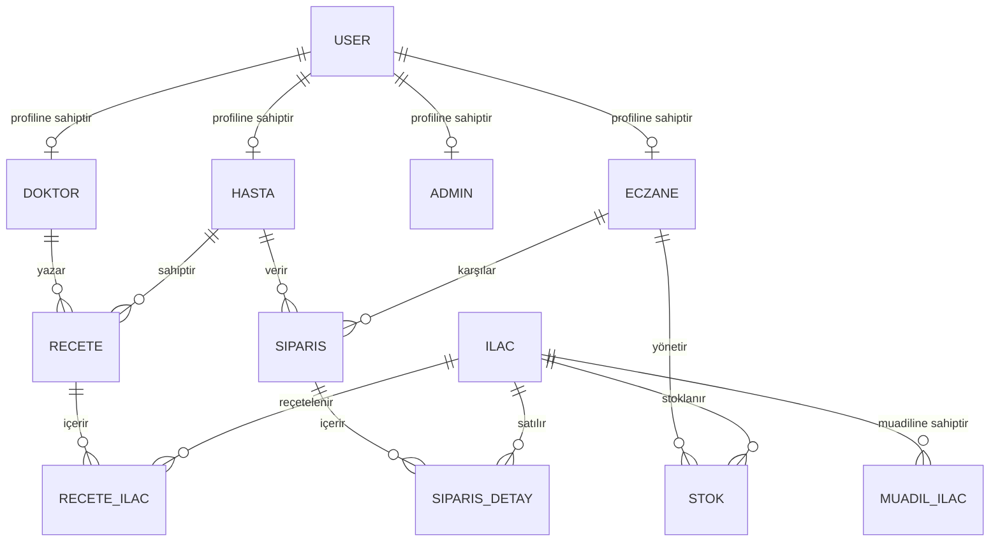

<div align="center">

# 💊 E-Eczane Sistemi
### Elektronik Eczane, Dijital Reçete & Polyglot Persistence Platformu

<p align="center">
  Modern, yüksek performanslı, rol tabanlı (RBAC) ve hibrit veritabanı mimarisine (SQL + NoSQL) sahip yeni nesil Elektronik Eczane Yönetim Sistemi.
</p>

[](https://fastapi.tiangolo.com/)
[](https://www.python.org/)
[](https://react.dev/)
[](https://vitejs.dev/)
[](https://www.postgresql.org/)
[](https://aws.amazon.com/dynamodb/)
[](https://tailwindcss.com/)
[](https://www.docker.com/)
[](LICENSE)

<br/>

[✨ Özellikler](#-öne-çıkan-özellikler) •
[🌐 Mimari](#-hibrit-mimari--polyglot-persistence) •
[🛠️ Teknoloji Yığını](#️-teknoloji-yığını) •
[📁 Proje Yapısı](#-proje-yapısı) •
[⚙️ Hızlı Kurulum](#️-adım-adım-kurulum) •
[🔑 Test Hesapları](#-hazır-test-hesapları) •
[🔌 API Endpoint'leri](#-api-mimarisi--endpointler) •
[🔒 Güvenlik](#-güvenlik-ve-gizlilik)

</div>

---

## 📖 Projeye Genel Bakış

**E-Eczane Sistemi**, sağlık sektöründeki reçete yazımından ilaç teslimatına kadar olan tüm süreçleri dijitalleştiren kapsamlı bir ekosistemdir. Doktorlar, eczacılar, hastalar ve sistem yöneticileri tek bir merkezi platform üzerinden haberleşerek sahte reçete riskini ortadan kaldırır, anlık stok takibini mümkün kılar ve hastalara mahalle/ilçe bazında en yakın eczaneden hızlı teslimat imkanı sunar.

Sistem, modern kurumsal yazılım mimarisi ilkelerine uygun olarak **Polyglot Persistence (Çoklu Veritabanı)** yaklaşımıyla geliştirilmiştir:
- **İlişkisel Veriler (PostgreSQL):** Finansal ve ACID gerektiren işlemler (Kullanıcılar, Reçeteler, Siparişler, Stoklar).
- **NoSQL Veriler (AWS DynamoDB):** Yüksek hacimli, şemasız ve hızlı büyüyen olaylar (Bildirimler, Sipariş Durum Denetim Logları, Sistem Logları).

---

## ✨ Öne Çıkan Özellikler

### 👨‍⚕️ Doktor Portalı
- 🔍 **Hasta Doğrulama:** TC Kimlik Numarası ile hasta sorgulama ve geçmiş reçete kayıtlarına erişim.
- 📝 **Dijital Reçete Oluşturma:** İlaç kataloğundan etken madde, kategori ve kullanım talimatı (dozaj/periyot) seçerek dijital reçete yazımı.
- 📂 **Reçete Arşivi:** Yazılan reçetelerin durumunu (kullanıldı / beklemede) canlı takip etme.

### 🏥 Eczane Portalı
- 📥 **Sipariş Yönetim Hattı:** Gelen siparişleri adım adım yönetme (`BEKLEMEDE` ➔ `ONAYLANDI` ➔ `HAZIRLANIYOR` ➔ `YOLDA` ➔ `TESLIM_EDILDI`).
- 💊 **Dinamik Stok Takibi:** İlaç envanterini görüntüleme, stok adedi ve fiyat güncelleme, tükenen ilaç uyarıları.
- 🔔 **Gerçek Zamanlı Bildirimler:** Yeni reçete veya sipariş geldiğinde anlık bildirim alma.

### 👤 Hasta Portalı
- 📜 **E-Reçete Görüntüleme:** Doktor tarafından yazılan reçeteleri ve reçete içeriğindeki ilaçları inceleme.
- 🔄 **Akıllı Muadil İlaç Önerisi:** Reçetedeki ilacın stokta olmaması durumunda aynı etken maddeye sahip muadil ilaçları görebilme.
- 📍 **Konum Bazlı Eczane Seçimi:** İl, ilçe ve mahalle filtreleriyle en yakın ve stok bulunan eczaneyi seçme.
- 🛒 **Sepet ve Güvenli Ödeme:** Reçeteli veya reçetesiz ürünleri sepete ekleme, simüle edilmiş kart/kapıda ödeme seçenekleri.
- 🚚 **Canlı Sipariş Takibi:** Siparişin eczanede hazırlanmasından kargoya ve teslimata kadar olan durumunu harita ve durum çubuğuyla izleme.

### 🛡️ Yönetici (Admin) Portalı
- 🏪 **Eczane Onaylama Mekanizması:** Ruhsat ve sicil numaralarını denetleyerek eczane kayıtlarını onaylama veya reddetme.
- 👥 **Kullanıcı Yönetimi:** Sistemdeki doktor, eczane ve hasta hesaplarını listeleme ve durumlarını yönetme.
- 📊 **Sistem Analitiği:** Toplam ciro, aktif sipariş sayısı, en çok satılan ilaçlar ve kullanıcı dağılım grafikleri.
- ⚡ **DynamoDB Benchmark & İzleme Paneli:** PostgreSQL ve AWS DynamoDB arasındaki gecikme (latency) sürelerini kıyaslama, NoSQL tablolarındaki denetim ve bildirim kayıtlarını canlı inceleme.

---

## 🌐 Hibrit Mimari & Polyglot Persistence

Sistem, monolitik tek-veritabanı yaklaşımının getirdiği darboğazları aşmak için hibrit veritabanı mimarisini benimsemiştir:

```
                                ┌──────────────────────────────────────┐
                                │          React 19 Frontend           │
                                │   (TailwindCSS + Redux Toolkit)      │
                                └──────────────────┬───────────────────┘
                                                   │  REST API / JSON
                                                   ▼
                                ┌──────────────────────────────────────┐
                                │           FastAPI Backend            │
                                │   (Pydantic v2 + SQLAlchemy ORM)     │
                                └──────────┬────────────────┬──────────┘
                                           │                │
                   ACID & İlişkisel İşlemler│                │ Append-Only & Audit Log
                                           ▼                ▼
                                ┌──────────────────┐ ┌──────────────────┐
                                │    PostgreSQL    │ │   AWS DynamoDB   │
                                │  (eczane_db)     │ │     (NoSQL)      │
                                ├──────────────────┤ ├──────────────────┤
                                │ • users          │ │ • bildirimler    │
                                │ • hastalar       │ │ • siparis_durum_ │
                                │ • eczaneler      │ │   gecmisi        │
                                │ • doktorlar      │ │ • sistem_loglari │
                                │ • ilaclar & stok │ │                  │
                                │ • siparisler     │ │                  │
                                └──────────────────┘ └──────────────────┘
```

### Neden İki Farklı Veritabanı?
1. **Veri Bütünlüğü (PostgreSQL):** İlaç stoklarının düşmesi, reçete kullanım kilidi ve ödeme işlemleri strictly ACID işlem bütünlüğü gerektirir.
2. **Yatay Ölçeklenebilirlik (DynamoDB):** Sipariş durum geçmişleri ve bildirimler append-only (yalnızca eklenen) verilerdir; zamanla milyonlarca satıra ulaştığında ilişkisel veritabanını yavaşlatmaz, milisaniye seviyesinde yazma performansı sağlar.

---

## 🛠️ Teknoloji Yığını

### Backend
| Bileşen | Teknoloji | Açıklama |
|---|---|---|
| **Web Framework** | FastAPI (Python) | Asenkron, OpenAPI destekli yüksek hızlı API |
| **ORM / Migration** | SQLAlchemy 2.0 & Alembic | İlişkisel veritabanı soyutlama ve şema yönetimi |
| **NoSQL Client** | boto3 | AWS DynamoDB resmi Python SDK |
| **Doğrulama (Validation)**| Pydantic v2 & Pydantic-Settings | Tip güvenliği ve ortam değişkeni yönetimi |
| **Kimlik Doğrulama** | python-jose & passlib (bcrypt) | JWT Token üretimi ve güvenli parola hashleme |
| **E-Posta Servisi** | aiosmtplib & email.mime | Şifre sıfırlama ve durum güncellemeleri için SMTP |
| **ASGI Server** | Uvicorn | Yüksek performanslı asenkron web sunucusu |

### Frontend
| Bileşen | Teknoloji | Açıklama |
|---|---|---|
| **Kütüphane** | React 19 | Deklaratif, modern bileşen tabanlı kullanıcı arayüzü |
| **Build Aracı** | Vite 6 | Lightning-fast HMR ve optimize edilmiş build süreci |
| **Stil / Tasarım** | Tailwind CSS | Utility-first, duyarlı (responsive) modern tasarım sistemi |
| **Durum Yönetimi** | Redux Toolkit | Merkezi global state yönetimi (Auth, Cart, User) |
| **Yönlendirme** | React Router v7 | Rol korumalı (Protected & RoleBased) istemci rotalama |
| **HTTP İstemcisi** | Axios | Interceptor destekli merkezi API haberleşmesi |
| **İkon Seti** | Lucide React | Modern, temiz SVG ikon koleksiyonu |
| **Bildirimler** | React Hot Toast | Kullanıcı dostu bildirim ve toast mesajları |

### Veritabanı & Altyapı
| Bileşen | Teknoloji | Açıklama |
|---|---|---|
| **İlişkisel Veritabanı** | PostgreSQL 15 | Containerize edilmiş ana ilişkisel veritabanı |
| **NoSQL Veritabanı** | AWS DynamoDB | Bulut tabanlı, dağıtık NoSQL belge veritabanı |
| **DB Yönetim Arayüzü** | pgAdmin 4 | Web tabanlı PostgreSQL yönetim konsolu |
| **Konteynerizasyon** | Docker & Docker Compose | İzole, tek komutla ayağa kalkan yerel ortam |

---

## 📁 Proje Yapısı

```bash
E-Eczane-Sistemi/
├── .gitignore                      # Kapsamlı master Git ignore dosyası
├── .gitattributes                  # Satır sonu (LF/CRLF) standardizasyonu
├── README.md                       # Proje dokümantasyonu
├── SUNUM_NOSQL_DYNAMODB.md         # NoSQL & DynamoDB teknik sunum rehberi
│
└── e_eczane/
    ├── docker-compose.yml          # PostgreSQL ve pgAdmin servisleri
    │
    ├── eczane-backend/             # 🚀 FastAPI Backend Uygulaması
    │   ├── app/
    │   │   ├── core/               # Konfigürasyon, veritabanı motoru, güvenlik, DynamoDB
    │   │   ├── models/             # SQLAlchemy ORM modelleri (User, Hasta, Eczane, vb.)
    │   │   ├── repositories/       # Veritabanı sorguları (SQL + DynamoDB Repositories)
    │   │   ├── routers/            # API Route tanımları (auth, hasta, eczane, doktor, admin)
    │   │   ├── schemas/            # Pydantic v2 veri şemaları (Request/Response DTO)
    │   │   ├── services/           # İş mantığı (Business Logic Layer)
    │   │   ├── utils/              # E-posta şablonları, enumlar ve yardımcı araçlar
    │   │   ├── scripts/            # Seed data ve migrasyon scriptleri
    │   │   └── main.py             # FastAPI uygulama başlangıç noktası
    │   ├── migrations/             # Veritabanı migrasyon dosyaları
    │   ├── tests/                  # Pytest birim ve entegrasyon testleri
    │   ├── requirements.txt        # Backend bağımlılıkları
    │   ├── .env.example            # Güvenli ortam değişkenleri şablonu
    │   └── .gitignore              # Backend'e özel ignore kuralları
    │
    └── eczane-frontend/            # 🎨 React 19 Frontend Uygulaması
        ├── src/
        │   ├── api/                # Axios API modülleri (authApi, hastaApi, cosmosApi vb.)
        │   ├── components/         # Yeniden kullanılabilir UI bileşenleri ve Layout'lar
        │   ├── pages/              # Sayfa görünümleri (admin, auth, doktor, eczane, hasta)
        │   ├── redux/              # Redux Toolkit store ve slice'lar (authSlice, hastaSlice)
        │   ├── utils/              # Sabitler, yardımcı fonksiyonlar ve adres verileri
        │   ├── App.jsx             # Rota yapılandırması ve yetki kontrolleri
        │   └── main.jsx            # React root mount noktası
        ├── package.json            # Node.js bağımlılıkları ve scriptler
        ├── tailwind.config.js      # Tailwind CSS tema yapılandırması
        ├── vite.config.js          # Vite derleme ayarları
        ├── .env.example            # Frontend ortam değişkeni şablonu
        └── .gitignore              # Frontend'e özel ignore kuralları
```

---

## ⚙️ Adım Adım Kurulum

### Ön Gereksinimler
- **Python:** 3.10 veya üzeri
- **Node.js:** v18 veya üzeri
- **Docker & Docker Compose:** Yüklü ve çalışır durumda olmalıdır
- **Git**

---

### 1️⃣ Depoyu Klonlayın

```bash
git clone https://github.com/AliFurkanOZ/E-Eczane-Sistemi.git
cd E-Eczane-Sistemi
```

---

### 2️⃣ Veritabanını Başlatın (Docker)

PostgreSQL ve pgAdmin servislerini arka planda başlatmak için:

```bash
cd e_eczane
docker-compose up -d
```
> PostgreSQL `localhost:5433` portunda, pgAdmin ise `http://localhost:5050` portunda hazır olacaktır.

---

### 3️⃣ Backend Kurulumu

Yeni bir terminal açın ve backend dizinine geçin:

```bash
cd e_eczane/eczane-backend

# 1. Sanal ortam (Virtual Environment) oluşturun
python -m venv venv

# 2. Sanal ortamı aktive edin:
# Windows (PowerShell):
.\venv\Scripts\Activate.ps1
# Linux / macOS:
source venv/bin/activate

# 3. Bağımlılıkları yükleyin
pip install -r requirements.txt

# 4. Ortam değişkenlerini hazırlayın
copy .env.example .env    # Windows
# cp .env.example .env     # Linux/Mac
```

> **Not:** `.env` dosyası varsayılan olarak yerel Docker PostgreSQL bağlantı ayarlarıyla hazırdır. İsteğe bağlı olarak e-posta veya AWS DynamoDB ayarlarınızı girebilirsiniz. AWS anahtarları girilmezse uygulama DynamoDB özelliklerini güvenli şekilde atlayarak PostgreSQL ile çalışmaya devam eder.

**Örnek Verileri (Seed Data) Yükleyin:**
Sistemi test etmek için gerekli kullanıcıları, ilaçları ve stokları tek komutla oluşturun:

```bash
python -m app.scripts.seed_data
python register_doktor.py
```

**Backend Sunucusunu Başlatın:**
```bash
uvicorn app.main:app --reload --host 0.0.0.0 --port 8000
```
Backend API artık `http://localhost:8000` adresinde çalışıyor! 🎉

---

### 4️⃣ Frontend Kurulumu

Yeni bir terminal açın ve frontend dizinine geçin:

```bash
cd e_eczane/eczane-frontend

# 1. Bağımlılıkları yükleyin
npm install

# 2. Ortam değişkenini oluşturun
copy .env.example .env    # Windows
# cp .env.example .env     # Linux/Mac

# 3. Geliştirme sunucusunu başlatın
npm run dev
```

Frontend arayüzü `http://localhost:5173` adresinde yayında olacaktır! 🚀

---

## 🔑 Hazır Test Hesapları

Sistemi hemen deneyimlemek için `seed_data` scripti tarafından üretilen test hesaplarını kullanabilirsiniz:

| Rol | E-Posta | Şifre | Tanımlı Bilgiler / Açıklama |
|---|---|---|---|
| 👑 **Admin** | `admin@eczane.com` | `Admin123!` | Sistem Yöneticisi, Eczane Onaylama & NoSQL Paneli |
| 👨‍⚕️ **Doktor** | `test.doktor@hospital.com` | `Test123!` | Dr. Mehmet Öz (Dahiliye - Ankara Hastanesi) |
| 🏥 **Eczane 1** | `merkez@eczane.com` | `Eczane123!` | Merkez Eczanesi (Onaylı - Çankaya/Ankara) |
| 🏥 **Eczane 2** | `yildiz@eczane.com` | `Eczane123!` | Yıldız Eczanesi (Onaylı - Yenimahalle/Ankara) |
| 🏥 **Eczane 3** | `yeni@eczane.com` | `Eczane123!` | Yeni Eczane (Onay Bekliyor statüsünde) |
| 👤 **Hasta 1** | `hasta1@test.com` | `Test123!` | Ahmet Yılmaz (TC: `12345678901` - Çankaya) |
| 👤 **Hasta 2** | `hasta2@test.com` | `Test123!` | Ayşe Demir (TC: `98765432109` - Yenimahalle) |

---

## 📊 Veritabanı Modeli (ER Diagram)



> 💡 **NoSQL Tabloları:** `bildirimler`, `siparis_durum_gecmisi` ve `sistem_loglari` verileri **AWS DynamoDB** üzerinde tutulduğu için ilişkisel ER diyagramında yer almaz; olay bazlı (event-driven) mikro yapılardır.

---

## 🔌 API Mimarisi & Endpoint'ler

FastAPI tarafından otomatik olarak oluşturulan interaktif API dokümantasyonuna şu bağlantılardan erişebilirsiniz:
- **Swagger UI:** [http://localhost:8000/docs](http://localhost:8000/docs)
- **ReDoc:** [http://localhost:8000/redoc](http://localhost:8000/redoc)

### Önemli Endpoint Özetleri:

| Modül | HTTP | Endpoint | Açıklama |
|---|---|---|---|
| **Auth** | `POST` | `/api/auth/login` | JWT Access ve Refresh token alımı |
| **Auth** | `POST` | `/api/auth/register-hasta` | Yeni hasta kaydı oluşturma |
| **Auth** | `POST` | `/api/auth/register-eczane` | Eczane sicil başvurusu yapma |
| **Auth** | `POST` | `/api/auth/forgot-password` | Şifre sıfırlama e-postası gönderme |
| **Hasta** | `GET` | `/api/hasta/receteler` | Hastaya ait reçeteleri listeleme |
| **Hasta** | `POST` | `/api/hasta/siparisler` | Reçeteli/reçetesiz sipariş oluşturma |
| **Hasta** | `GET` | `/api/hasta/eczaneler` | Konuma göre uygun eczaneleri arama |
| **Eczane**| `GET` | `/api/eczane/siparisler` | Eczaneye gelen siparişleri listeleme |
| **Eczane**| `PUT` | `/api/eczane/siparisler/{id}/durum` | Sipariş durumunu güncelleme (Onayla/Yola Çıkar) |
| **Eczane**| `GET` | `/api/eczane/stok` | Mevcut ilaç stoğu ve fiyatları |
| **Doktor**| `POST` | `/api/doktor/recete` | Hastaya yeni e-reçete yazma |
| **Doktor**| `GET` | `/api/doktor/hastalar/{tc_no}` | TC No ile hasta doğrulama |
| **Admin** | `GET` | `/api/admin/eczaneler/bekleyen` | Onay bekleyen eczane başvuruları |
| **Admin** | `PUT` | `/api/admin/eczaneler/{id}/onayla` | Eczane ruhsatını onaylama |
| **NoSQL** | `GET` | `/api/cosmos/benchmark` | PostgreSQL vs DynamoDB gecikme analizi |

---

## 🧪 Testleri Çalıştırma

Backend test suite'i Pytest altyapısı ile hazırlanmıştır:

```bash
cd e_eczane/eczane-backend

# Tüm testleri koşturun
pytest

# Detaylı çıktı ile testleri koşturun
pytest -v -s
```

---

## 🔒 Güvenlik ve Gizlilik

Bu proje modern güvenlik standartları gözetilerek yapılandırılmıştır:
- **Secrets Isolation:** Gerçek API anahtarları, SMTP şifreleri ve gizli JWT anahtarları kod tabanına dahil edilmez; `.env.example` şablonları üzerinden izole tutulur.
- **Çok Katmanlı `.gitignore`:** Kök, backend ve frontend seviyelerinde yapılandırılan ignore kuralları; `.env`, `.pem`, SQLite (`.db`), log ve derlenmiş python bytecode (`__pycache__`) dosyalarının depoya sızmasını kesin olarak engeller.
- **Şifreleme (Encryption):** Tüm kullanıcı şifreleri tek yönlü `bcrypt` algoritması ile salt'lanarak veritabanında saklanır.
- **JWT & RBAC:** Tüm istekler `Bearer` token doğrulamasına ve endpoint seviyesinde tanımlı rol filtrelerine (`UserType.ADMIN`, `UserType.ECZANE`, vb.) tabidir.

---

## 🤝 Katkıda Bulunma

1. Bu depoyu Fork edin (`Fork` butonuna tıklayın)
2. Yeni bir özellik dalı oluşturun (`git checkout -b feature/harika-ozellik`)
3. Değişikliklerinizi commit edin (`git commit -m 'feat: Yeni harika özellik eklendi'`)
4. Dalınıza push edin (`git push origin feature/harika-ozellik`)
5. Bir **Pull Request** açın

---

## 📄 Lisans

Bu proje **[MIT Lisansı](LICENSE)** altında lisanslanmıştır. Eğitim, kişisel gelişim ve ticari projelerinizde serbestçe kullanabilirsiniz.

---

## 👨‍💻 Geliştirici & İletişim

**Ali Furkan ÖZ**
- **GitHub:** [@AliFurkanOZ](https://github.com/AliFurkanOZ)
- **Proje Bağlantısı:** [https://github.com/AliFurkanOZ/E-Eczane-Sistemi](https://github.com/AliFurkanOZ/E-Eczane-Sistemi)

<div align="center">
  <sub>Sağlık teknolojilerinde yenilikçi, güvenilir ve modern dijital çözümler için tasarlandı. ⭐ Yıldız vermeyi unutmayın!</sub>
</div>
